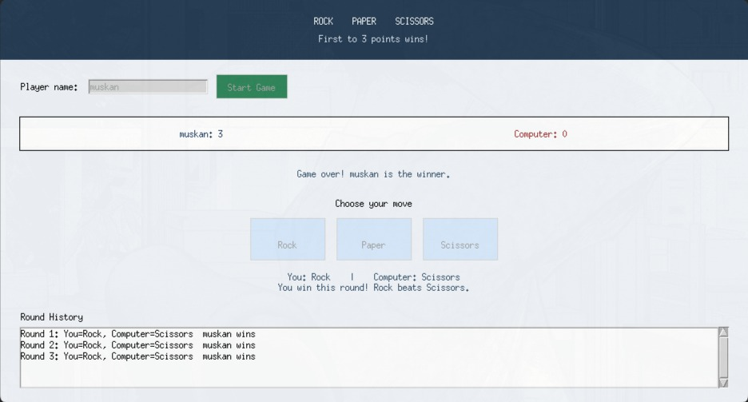

# Rock, Paper, Scissors

A desktop Rock, Paper, Scissors game built with **Python** and **Tkinter**. Play against the computer in a first-to-three-points match.

## Game screenshot



## Features

- Enter a player name before starting.
- Choose Rock, Paper, or Scissors using the on-screen buttons.
- The computer chooses its move randomly.
- Scores update after each round; draws do not award a point.
- The first side to reach **3 points** wins the match.
- View round-by-round results in the game window.
- Start a new match without restarting the application.
- Automatically save completed match summaries to `match_history.txt`.

## Requirements

- Python 3.8 or later recommended.
- Tkinter, which is included with many standard Python installations.
- No third-party Python packages are required.

## Project structure

```text
Rock_Paper_Scissors_Project/
├── rock_paper_scissors.py   # Main game application
├── match_history.txt        # Completed match records
└── README.md                # Project documentation
```

## Getting started

### 1. Extract the project

If you downloaded the project as a ZIP file, extract it and open a terminal or command prompt in the extracted project folder.

### 2. Check Python

Run:

```bash
python --version
```

On macOS or some Linux systems, use:

```bash
python3 --version
```

### 3. Check Tkinter

Run:

```bash
python -m tkinter
```

If your system uses `python3`, run:

```bash
python3 -m tkinter
```

A small Tkinter test window should appear. Close it to continue. If Tkinter is missing, install the Tkinter package appropriate for your operating system or Python distribution.

### 4. Start the game

From the project folder, run:

```bash
python rock_paper_scissors.py
```

Or, where needed:

```bash
python3 rock_paper_scissors.py
```

The game window will open.

## How to play

1. Enter your name in the **Player name** field.
2. Click **Start Game**.
3. Select **Rock**, **Paper**, or **Scissors** for each round.
4. The computer's move and the round result will appear in the window.
5. The first player (you or the computer) to score 3 points wins.
6. Click **New Game** to reset the scores and play again, or **Exit** to close the application.

### Game rules

- Rock beats Scissors.
- Scissors beats Paper.
- Paper beats Rock.
- Matching choices result in a draw and neither side receives a point.

## Match history

After a match finishes, the application appends a record containing the date and time, player name, final scores, and winner to `match_history.txt`.

The file is opened relative to the application's **current working directory**. For predictable results, run the script from the project folder.

## Troubleshooting

- **The game window does not open:** Confirm that Python and Tkinter are installed and available in the same Python environment.
- **`python` is not recognized:** Try `python3` (macOS/Linux) or use the Python launcher `py` on Windows.
- **Tkinter is unavailable:** Install the Tkinter support package for your operating system/Python distribution, then repeat the Tkinter check.
- **Match history is not appearing in the project folder:** Run the application with the project folder as the current working directory and check that the folder is writable.

## License

No license is specified for this project. Add a license file if you intend to distribute or reuse the code under particular terms.
